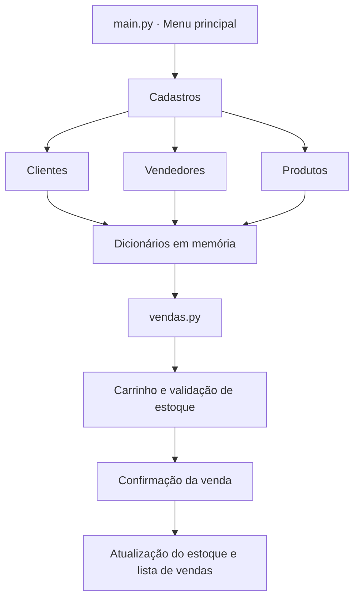

<div align="center">

# 🛒 PDV em Python

### Sistema de Ponto de Venda · A3 de Algoritmos e Programação

Um projeto acadêmico de **gestão de cadastros e vendas pelo terminal**, desenvolvido em equipe para aplicar os fundamentos da programação em Python.


**[Sobre o projeto](#-sobre-o-projeto) · [Funcionalidades](#-funcionalidades) · [Como executar](#-como-executar) · [Estrutura](#-estrutura-do-projeto) · [Próximos passos](#-próximos-passos)**

</div>

---

## 📖 Sobre o projeto

Este repositório contém um **sistema de Ponto de Venda (PDV)** desenvolvido para a atividade **A3 da disciplina de Algoritmos e Programação**.

A proposta é simular operações básicas de um estabelecimento comercial por meio de uma aplicação de terminal: cadastrar clientes, vendedores e produtos; consultar registros; e construir um fluxo de vendas que relacione esses cadastros.

O código é dividido em arquivos Python para facilitar a divisão de tarefas do grupo e a compreensão dos conceitos estudados em sala:

- **Dicionários e listas** para organizar os registros;
- **Funções** para separar responsabilidades;
- **Condicionais e laços** para controlar menus e validações;
- **Imports e parâmetros** para compartilhar dados entre módulos.

> [!NOTE]
> **Projeto educacional em desenvolvimento.** Os registros ficam em memória durante a execução: ainda não existe banco de dados nem salvamento persistente. O fluxo completo de vendas tem pendências de integração descritas abaixo.

## ✨ Funcionalidades

| Módulo | O que o código contempla | Situação |
| :--- | :--- | :---: |
| 👤 **Clientes** | Cadastro com nome, data de nascimento, idade calculada, endereço e CPF | ✅ Implementado |
| 🧑‍💼 **Vendedores** | Cadastro com informações pessoais e cálculo de idade | ✅ Implementado |
| 📦 **Produtos** | Cadastro de nome, preço, quantidade em estoque e data de validade | ✅ Implementado |
| 📅 **Validade** | Indicação de produto dentro da validade, vencido ou que vence hoje | ✅ Implementado |
| 🛒 **Vendas** | Seleção de cadastros, carrinho, quantidades, subtotal, confirmação e baixa de estoque | 🚧 Integração pendente |
| 💰 **Comissão** | Cálculo de **5%** sobre o valor da venda no módulo de vendas | 🚧 Integrado ao fluxo de vendas |
| 🧾 **Consulta de vendas** | Opção presente no menu principal; exibição de vendas registradas ainda não implementada | ⏳ Pendente |

**Sobre as validações:** atualmente o CPF passa por conferência de comprimento e caracteres numéricos; isso **não equivale à validação dos dígitos verificadores**. As datas de nascimento também são usadas no cálculo de idade, mas entradas inválidas ainda precisam de tratamento adicional.

## 💻 Como executar

### Pré-requisitos

- **Python 3** instalado (recomenda-se uma versão recente, como Python 3.10+);
- Um terminal;
- **Nenhuma biblioteca externa** é necessária na versão atual.

### 1. Clone o repositório

```bash
git clone https://github.com/Jeffrin1823/A3_ALGORITMOS_E_PROGRAMACAO_PDV.git
cd A3_ALGORITMOS_E_PROGRAMACAO_PDV
```

### 2. Inicie o programa

**Linux / macOS:**

```bash
python3 main.py
```

**Windows (Python Launcher):**

```powershell
py main.py
```

### 3. Navegue pelo menu

O terminal apresenta opções para acessar os cadastros, iniciar uma venda, visualizar clientes, vendedores e produtos, consultar vendas e encerrar o programa.

**Fluxo de uso previsto:**

1. Acesse o **menu de cadastro**.
2. Cadastre pelo menos um **cliente**, um **vendedor** e um **produto**.
3. Consulte os registros para visualizar os códigos gerados.
4. Acesse **Realizar venda** para selecionar os registros e adicionar produtos ao carrinho.
5. Confira os totais e confirme a operação.

> [!WARNING]
> O fluxo de vendas ainda precisa de ajustes para funcionar de ponta a ponta na branch `main`. Consulte [Limitações conhecidas](#-limitações-conhecidas) antes de testar essa etapa.

## 🗂️ Estrutura do projeto

```text
A3_ALGORITMOS_E_PROGRAMACAO_PDV/
├── main.py                  # Menu e ponto de entrada do programa
├── cadastro_cliente.py      # Cadastro e consulta de clientes
├── cadastro_vendedores.py   # Cadastro e consulta de vendedores
├── cadastro_produto.py      # Cadastro e consulta de produtos
├── vendas.py                # Lógica do carrinho e das vendas
└── README.md                # Documentação
```

Cada módulo de cadastro **retorna um dicionário**. A `main.py` guarda esses dicionários e os passa como argumentos para as funções de vendas, sem precisar refazer os cadastros durante cada operação.



*O diagrama representa o fluxo pretendido entre os módulos. A integração de vendas ainda tem ajustes pendentes.*

## 🧠 Conceitos aplicados

| Conceito | Aplicação no PDV |
| :--- | :--- |
| **Dicionários** | Clientes, vendedores, produtos e itens do carrinho |
| **Listas** | Armazenamento das vendas durante a execução |
| **Funções** | Rotinas de cadastro, exibição e vendas |
| **`if` / `elif` / `else`** | Menus, decisões e validações |
| **`while` / `for`** | Repetição de menus e percurso dos registros |
| **`return`** | Devolução dos dados cadastrados para a função principal |
| **Importação de módulos** | Separação das funcionalidades em arquivos `.py` |
| **`datetime` / `date`** | Cálculo de idade, registro de data e análise da validade |

## 🚧 Limitações conhecidas

A versão atual ainda apresenta pontos que serão tratados durante o desenvolvimento:

- **Integração de vendas:** `cadastro_vendedores.py` armazena o nome com a chave `"Nome"`, enquanto `vendas.py` tenta acessar `"nome"`. Isso pode provocar `KeyError` no fluxo de vendas.
- **Códigos dos registros:** a apresentação usa prefixos como `CL`, `VD` e `PR`, mas as chaves armazenadas nos dicionários são apenas os números formatados. A leitura dos códigos deve ser padronizada.
- **Recadastramento:** chamar novamente uma função de cadastro substitui o respectivo dicionário na `main.py`, descartando os registros anteriores daquela categoria.
- **Consulta de vendas:** a opção do menu ainda não imprime o histórico quando existem vendas cadastradas.
- **Tratamento de entradas:** números ou datas malformados podem interromper a execução; algumas validações ainda são básicas.
- **Persistência:** todos os registros são perdidos quando o programa é encerrado.

Esses pontos são **pendências identificadas no código**, não funcionalidades prontas.

## 🗺️ Próximos passos

- [x] Separar o projeto em módulos Python.
- [x] Criar menu principal e menu de cadastros.
- [x] Implementar cadastros de clientes, vendedores e produtos.
- [x] Calcular a idade a partir da data de nascimento.
- [x] Exibir a situação de validade dos produtos.
- [x] Estruturar o carrinho e as regras básicas de venda.
- [ ] Padronizar os códigos e as chaves usados entre cadastros e vendas.
- [ ] Garantir que novos cadastros não substituam os anteriores.
- [ ] Finalizar e testar o fluxo completo de venda.
- [ ] Implementar consulta de vendas e emissão de recibos.
- [ ] Reforçar o tratamento de entradas inválidas.
- [ ] Desenvolver a etapa de relatório financeiro da A3.

## 🤝 Trabalho em equipe

O projeto é desenvolvido de maneira colaborativa, com funcionalidades distribuídas entre os integrantes do grupo.

Para propor alterações sem modificar diretamente a versão principal:

```bash
git switch -c feat/nome-da-funcionalidade
git add arquivo_alterado.py
git commit -m "feat: descreve a alteração"
git push -u origin feat/nome-da-funcionalidade
```

Depois, abra um **Pull Request** no GitHub para revisão e integração. Quando duas pessoas alteram as mesmas linhas, o merge pode exigir resolução manual de conflitos.

Acompanhe as contribuições em **[Contributors](https://github.com/Jeffrin1823/A3_ALGORITMOS_E_PROGRAMACAO_PDV/graphs/contributors)**.

---

<div align="center">

**Feito em Python, com foco em aprender os fundamentos de programação na prática.** 🐍

[Acessar o repositório](https://github.com/Jeffrin1823/A3_ALGORITMOS_E_PROGRAMACAO_PDV)

</div>
